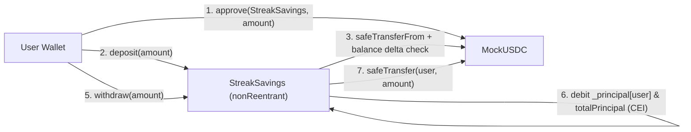

# StreakSave Smart Contract Architecture

**Status:** Principal Accounting & Epoch Clock Implemented; Streak, Weight, and Reward Layers Blocked Pending BL Decisions  
**Solidity Compiler:** `0.8.24` (`evm_version = "shanghai"`, optimizer enabled, `200` runs)  
**Dependencies:** OpenZeppelin Contracts `v5.6.1` (`ERC20`, `IERC20`, `SafeERC20`, `ReentrancyGuard`, `SafeCast`)  
**Network Target:** Avalanche Fuji C-Chain (`chainId = 43113`)

---

## 1. Contract Inventory & Responsibilities

| File | Status | Responsibility |
|---|---|---|
| [`contracts/src/MockUSDC.sol`](../contracts/src/MockUSDC.sol) | **Implemented** | Test-only 6-decimal ERC-20 (`Mock USDC` / `USDC`) with zero initial supply and immutable deployer-only `minter`. |
| [`contracts/src/StreakSavings.sol`](../contracts/src/StreakSavings.sol) | **Partial (Principal + Epoch Clock)** | Non-upgradeable savings vault holding user principal (`deposit`, `withdraw`, `principalOf`, `totalPrincipal`) and global configurable epoch clock (`currentEpoch`, `epochAt`, `epochStart`, `epochEnd`, `nextEpochTimestamp`, `timeUntilNextEpoch`). |
| [`contracts/src/libraries/StreakAccountingMath.sol`](../contracts/src/libraries/StreakAccountingMath.sol) | **Implemented (Pure Library)** | Pure math primitives for confirmed epoch/streak transitions, `-old + new` weight delta updates, and Model A / Model B reward formulas. Explicitly gates unapproved BL-01 same-epoch transitions. |
| [`contracts/script/Deploy.s.sol`](../contracts/script/Deploy.s.sol) | **Implemented** | Chain-validated, env-checked deployment & post-deploy verification script for Avalanche Fuji (`43113`) and optional local Anvil (`31337`). |

### Intentionally Absent (Blocked on Team Business Logic Decisions)

The following components are **not** yet implemented on `StreakSavings.sol` because they depend on unapproved decisions in [`docs/MEMBER-A-TECHNICAL-DECISIONS.md`](./MEMBER-A-TECHNICAL-DECISIONS.md):
- Per-user streak state and `streakOf(address)` (blocked on **BL-01**, **BL-02**, **BL-09**).
- Per-user weight, `totalWeight`, and zero-principal eligibility (blocked on **BL-02**, **BL-03**, **BL-04**).
- Mock yield pool, `addMockYield(uint256)`, `rewardOf(address)`, `claimReward()` (blocked on **BL-06**, **BL-07**, **BL-10**, **BL-11**, **BL-13**).

---

## 2. Implemented Storage & Immutable Layout

### `MockUSDC.sol`
- Inherits OpenZeppelin `ERC20("Mock USDC", "USDC")` (`balances`, `allowances`, `totalSupply`, `name`, `symbol`).
- `address public immutable minter` — set once to `msg.sender` in `constructor()`.
- Overrides `decimals()` to return constant `6`.

### `StreakSavings.sol`
| Variable | Kind | Type | Purpose |
|---|---|---|---|
| `usdc` | `immutable` | `IERC20` | Token accepted for principal deposits (validated non-zero & `code.length > 0`). |
| `epochDuration` | `immutable` | `uint64` | Seconds per epoch (validated `> 0` at deploy; e.g., `60` demo / `604800` prod). |
| `startTime` | `immutable` | `uint64` | Deployment `block.timestamp` anchoring epoch `0` (`SafeCast.toUint64`). |
| `totalPrincipal` | Slot 0 (after OZ `_status`*) | `uint256` | Sum of all recorded user principal across `_principal`. |
| `_principal` | Mapping slot | `mapping(address => uint256)` | Per-user recorded principal, updated exclusively via `deposit` and `withdraw`. |

*\*Note: `ReentrancyGuard` uses OpenZeppelin v5 `uint256 private _status` at slot 0, placing `totalPrincipal` at slot 1 and `_principal` base slot at slot 2.*

---

## 3. Implemented Subsystems

### 3.1 Principal Accounting Flow (`StreakSavings.sol`)

**Implemented Principal Invariants:**
1. `totalPrincipal == Σ _principal[user]` across all users.
2. `usdc.balanceOf(address(streakSavings)) >= totalPrincipal` at all times (equality holds unless tokens are donated directly).
3. Direct `ERC20.transfer` donations to `StreakSavings` do **not** alter `totalPrincipal` or any user's `_principal`.
4. Fee-on-transfer / under-delivering tokens revert in `deposit()` with `StreakSavings__TransferMismatch(expected, received)`.
5. `withdraw(amount)` enforces `amount > 0` and `amount <= _principal[msg.sender]`, mutates state before transferring (`CEI`), and protects both external token calls with `nonReentrant`.

### 3.2 Global Epoch Clock (`StreakSavings.sol`)

Epoch indices derive deterministically from `block.timestamp` with zero admin control:
- `currentEpoch() = (block.timestamp - startTime) / epochDuration`
- `epochStart(E) = startTime + E * epochDuration`
- `epochEnd(E) = startTime + (E + 1) * epochDuration`
- `nextEpochTimestamp() = epochEnd(currentEpoch())`
- `timeUntilNextEpoch() = epochEnd(currentEpoch()) - block.timestamp` (always in `[1, epochDuration]`)
- `epochAt(timestamp)` reverts with `StreakSavings__TimestampBeforeStart` if `timestamp < startTime` and uses `SafeCast.toUint64` against `uint64` truncation.

### 3.3 Confirmed Accounting Math Primitives (`StreakAccountingMath.sol`)

Isolated as pure library helpers ready for integration once BL decisions are approved:
- `classifyEpochTransition(lastDepositEpoch, currentEpoch, hasDepositedBefore)` -> `FirstDeposit | SameEpoch | ConsecutiveEpoch | MissedEpoch`
- `computeConfirmedStreakTransition(currentStreak, relation)`:
  - `FirstDeposit -> 1`
  - `ConsecutiveEpoch -> currentStreak + 1`
  - `MissedEpoch -> 1`
  - `SameEpoch -> revert StreakAccountingMath__UnapprovedSameEpochRule()` (until BL-01 is resolved)
- `applyWeightDelta(totalWeight, oldUserWeight, newUserWeight)` -> `totalWeight - oldUserWeight + newUserWeight` (Plan §16.4 Safeguard 5)
- `computeEpochRewardShare(epochPool, userWeight, totalWeight)` -> `(epochPool * userWeight) / totalWeight` (Model A)
- `computeAccumulatorDelta` / `computeAccruedReward` -> `PRECISION`-scaled accumulator math (Model B)

---

## 4. Planned (Unimplemented) Architecture After BL Approval

Once **BL-01, BL-02, BL-03, BL-10, BL-11, and BL-13** are approved by Team Dimple:
1. **Streak & Weight Layer** will hook into `deposit()` and `withdraw()` using `currentEpoch()`, `StreakAccountingMath`, and the chosen BL-01/02/03 rules.
2. **Reward Layer** (`rewardPool` / `rewardPoolInEpoch`, `addMockYield`, `rewardOf`, `claimReward`, and `claimRewardFor` if Model A is selected) will remain strictly isolated from `totalPrincipal` (`usdc.balanceOf(address(this)) >= totalPrincipal + rewardPool`).
3. **Public ABI Export** will generate `shared/abi/` and `shared/config/` artifacts in coordination with Member B and Member C before Avalanche Fuji deployment.
