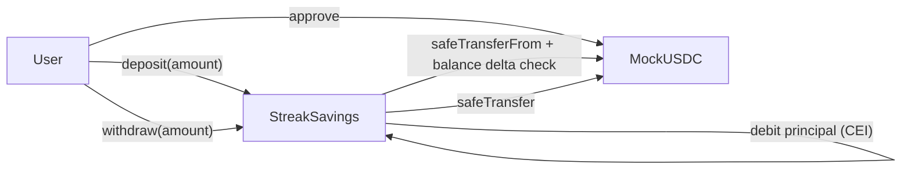

# StreakSave Smart Contract Architecture

**Status:** Final MVP implementation complete (principal, epoch clock, streak, weight, epoch-scoped mock rewards, claims).  
**Solidity Compiler:** `0.8.24` (`evm_version = "shanghai"`, optimizer enabled, `200` runs)  
**Dependencies:** OpenZeppelin Contracts `v5.6.1` (`ERC20`, `IERC20`, `SafeERC20`, `ReentrancyGuard`, `SafeCast`, `Math`)  
**Network Target:** Avalanche Fuji C-Chain (`chainId = 43113`)  
**Branch:** `feature/principal-accounting`

---

## 1. Contract Inventory

| File | Status | Responsibility |
|---|---|---|
| [`contracts/src/MockUSDC.sol`](../contracts/src/MockUSDC.sol) | **Complete** | Test-only 6-decimal ERC-20 (`Mock USDC` / `USDC`), zero initial supply, immutable deployer-only `minter`. |
| [`contracts/src/StreakSavings.sol`](../contracts/src/StreakSavings.sol) | **Complete** | Principal vault, global epoch clock, streak/weight accounting, epoch-scoped mock yield, reward claims. |
| [`contracts/src/libraries/StreakAccountingMath.sol`](../contracts/src/libraries/StreakAccountingMath.sol) | **Complete** | Pure epoch/streak classification, weight delta, and Model A reward share math. |
| [`contracts/script/Deploy.s.sol`](../contracts/script/Deploy.s.sol) | **Complete** | Chain-validated, env-checked deployment and post-deploy verification. |

---

## 2. Storage Layout

### `MockUSDC.sol`
- OpenZeppelin `ERC20("Mock USDC", "USDC")`.
- `address public immutable minter` = deployer.
- `decimals()` overridden to `6`.

### `StreakSavings.sol`

| Variable | Kind | Purpose |
|---|---|---|
| `usdc` | `IERC20 immutable` | Token for principal and mock yield. |
| `epochDuration` | `uint64 immutable` | Seconds per epoch (60 demo / 7 days production concept). |
| `startTime` | `uint64 immutable` | Deployment timestamp anchoring epoch 0. |
| `yieldProvider` | `address immutable` | Deployer/demo account allowed to fund mock yield. |
| `totalPrincipal` | `uint256` | Sum of recorded user principal. |
| `totalWeight` | `uint256` | Sum of cached user weights. |
| `totalRewardPool` | `uint256` | Yield funded minus reward amounts claimed (includes dust). |
| `_users` | `mapping(address => UserInfo)` | Principal, stored streak, last check-in epoch, cached weight. |
| `weightInEpoch` | `mapping(address => mapping(uint64 => uint256))` | End-of-epoch weight snapshot per user. |
| `totalWeightInEpoch` | `mapping(uint64 => uint256)` | End-of-epoch total weight. |
| `rewardPoolInEpoch` | `mapping(uint64 => uint256)` | Yield assigned to each epoch. |
| `claimedInEpoch` | `mapping(address => mapping(uint64 => bool))` | Double-claim protection. |

```solidity
struct UserInfo {
    uint256 principal;
    uint64 streak;
    uint64 lastDepositEpoch;
    uint256 weight;
}
```

`ReentrancyGuard` stores its `_status` in slot 0; `totalPrincipal` follows it. The contract is non-upgradeable.

---

## 3. Principal Accounting



- `principalOf(user)` and `totalPrincipal` are the only principal source of truth.
- `usdc.balanceOf(address(this))` is never used as accounting.
- `deposit` rejects zero, pulls tokens, verifies `received == amount`, then credits.
- `withdraw` rejects zero and over-withdrawal, updates state before transferring.
- Both entry points are `nonReentrant`.
- Invariants:
  1. `totalPrincipal == Σ principalOf(user)`.
  2. `usdc.balanceOf(address(this)) >= totalPrincipal + totalRewardPool`.
  3. Direct donations never increase principal or rewards.
  4. Fee-on-transfer deposits revert with `StreakSavings__TransferMismatch`.

---

## 4. Epoch Clock

All users share one clock anchored at deployment:

```text
currentEpoch() = (block.timestamp - startTime) / epochDuration
epochStart(E)  = startTime + E * epochDuration
epochEnd(E)    = startTime + (E + 1) * epochDuration
```

- `epochAt(timestamp)`, `nextEpochTimestamp()`, `timeUntilNextEpoch()`, `isEpochFinalized(epoch)` are exposed.
- No `advanceEpoch()` admin function.
- A timestamp exactly on a boundary belongs to the new epoch.
- `epochDuration == 0` is rejected.

---

## 5. Streak and Weight Rules (BR-01..BR-03)

| Situation | Result |
|---|---|
| First deposit ever | `streak = 1` |
| Additional deposit in the same epoch | principal increases; streak and weight unchanged |
| Deposit in the next epoch | `streak += 1` |
| Deposit after missing one or more epochs | `streak = 1` |
| Full withdrawal (`principal == 0`) | `streak = 0`, `weight = 0`, `lastDepositEpoch = 0` |
| Partial withdrawal | principal decreases; streak and weight unchanged |

- `weight = streak` while `principal > 0`; otherwise `weight = 0`.
- `totalWeight` is updated with `-oldWeight + newWeight` (never additive).
- `streakOf` returns the stored streak. `effectiveStreakOf` returns `0` when at least one full epoch has been missed, and is intended for UI display.
- `totalWeight` is a cached aggregate updated on user actions. Per-epoch snapshots are the authoritative reward weights; users who stop checking in do not dilute an epoch they did not join.

---

## 6. End-of-Epoch Weight Snapshots (BR-04)

Solidity cannot execute at epoch boundaries, so finalization is **lazy and time-gated**:

1. `deposit` and `withdraw` compute `epoch = currentEpoch()` and write only
   `weightInEpoch[user][epoch]` and `totalWeightInEpoch[epoch]`.
2. No function ever writes an epoch other than the current one.
3. Once `currentEpoch()` advances, the previous epoch's mappings are unreachable for writes.
4. Therefore the last value written during epoch `E` **is** the end-of-epoch snapshot.
5. `claimReward`/`claimRewardFor` require `epoch < currentEpoch()`, making finalization explicit without a transaction or a user loop.

### What the snapshot contains

- A user who deposited in `E` contributes their **end-of-epoch weight** (streak after the last deposit in `E`).
- A user who did not deposit in `E` has `weightInEpoch[user][E] == 0` and does not share `E`'s pool.
- A full withdrawal during `E` removes the user's current-epoch weight (`0` at the end).
- A full withdrawal after `E` closes cannot alter `E`'s snapshot.
- Multiple deposits in `E` never change the streak, so the snapshot is stable.

### Why this does not loop

Each user action is O(1). No operation enumerates users or epochs. The snapshot is maintained incrementally by the only actions that can change it.

---

## 7. Reward Accounting (BR-04..BR-06)

### Funding

- `addMockYield(amount)` is restricted to the immutable `yieldProvider` (the deployer/demo account).
- Yield is assigned to `currentEpoch()`.
- It reverts with `NoActiveWeight(epoch)` if that epoch has no checked-in weight.
- The provider must `approve` `StreakSavings` before funding.
- This is mock yield only; no real DeFi yield is represented.

### Distribution

```text
reward(user, E) = rewardPoolInEpoch[E] * weightInEpoch[user][E] / totalWeightInEpoch[E]
```

- Floor division via OpenZeppelin `Math.mulDiv`.
- Rounding dust stays in the contract and remains part of `totalRewardPool`; it is never redistributed or confiscated.
- `totalRewardPool` is incremented by yield and decremented by claimed amounts. Direct donations only create surplus.
- A user can claim an epoch at most once (`claimedInEpoch`).
- Unclaimed rewards never expire.

### Claim API and `rewardOf` semantics

| Function | Behavior |
|---|---|
| `rewardOf(user)` | Claimable reward for the **latest finalized epoch** (`currentEpoch() - 1`) only. Returns 0 if none/claimed. |
| `rewardInEpoch(user, epoch)` | Claimable reward for a specific finalized, unclaimed epoch. |
| `claimReward()` | Claims the latest finalized epoch (`currentEpoch() - 1`). Preserves the frontend zero-argument ABI. |
| `claimRewardFor(epoch)` | Claims a specific finalized epoch; used for older unclaimed rewards. |

`rewardOf` deliberately does **not** sum all historical epochs. Summing an unbounded history inside a view would require a loop. Older rewards remain permanently claimable through `claimRewardFor` and readable through `rewardInEpoch`. The frontend should surface epoch history if it wants to display a lifetime total.

### Zero-weight / stuck-pool edge

If yield is added to an epoch and every participant later fully withdraws before that epoch closes, the epoch's `totalWeightInEpoch` becomes zero. The pool remains in `totalRewardPool` and the contract balance backs it, but no user is entitled to it. It is not redistributed. This is documented as unallocated dust/reserve, not principal loss.

---

## 8. Access Control

| Action | Who |
|---|---|
| `deposit`, `withdraw` | Any user, for their own principal. |
| `addMockYield` | Immutable `yieldProvider` (deployer/demo account). |
| `claimReward`, `claimRewardFor` | Any user, for their own reward. |
| `MockUSDC.mint` | Immutable deployer minter. |

There is no owner, pause, upgrade, rescue, blacklist, or fee switch on `StreakSavings`.

---

## 9. Events and Errors

### Events

- `Deposit(address indexed user, uint256 amount)`
- `Withdraw(address indexed user, uint256 amount, uint256 principalRemaining)`
- `StreakUpdated(address indexed user, uint64 indexed epoch, uint64 oldStreak, uint64 newStreak)`
- `StreakReset(address indexed user, uint64 indexed epoch, uint64 previousStreak)`
- `MockYieldAdded(address indexed provider, uint64 indexed epoch, uint256 amount, uint256 epochRewardPool)`
- `RewardClaimed(address indexed user, uint64 indexed epoch, uint256 amount)`

The existing `Deposit` and `Withdraw` signatures are unchanged; streak information is a separate event.

### Custom errors

`StreakSavings__InvalidToken`, `InvalidEpochDuration`, `ZeroAmount`, `InsufficientPrincipal`, `TransferMismatch`, `TimestampBeforeStart`, `UnauthorizedYieldProvider`, `NoActiveWeight`, `EpochNotFinalized`, `RewardAlreadyClaimed`, `NoReward`, `NoFinalizedEpoch`.

---

## 10. Test Coverage Summary

| Suite | Focus |
|---|---|
| `Deploy.t.sol` | Chain/key/duration validation, Fuji and Anvil dry runs |
| `MockUSDC.t.sol` | Metadata, decimals, mint authority, zero address, fuzz |
| `StreakAccountingMath.t.sol` | Epoch classification, streak transitions, weight delta, Model A/B math |
| `StreakSavings.t.sol` | Principal, epoch clock, boundaries, fee-on-transfer, reentrancy |
| `StreakSavings.rewards.t.sol` | T1–T8 integration, streak rules, claims, dust, unauthorized yield, claim reentrancy, fuzz |
| `StreakSavings.invariant.t.sol` | Principal solvency, weight consistency |
| `StreakSavings.rewards.invariant.t.sol` | Principal + reward solvency, pool conservation, epoch weight snapshots |

**Current result:** 103 tests passed, 0 failed, 0 skipped; both invariant suites complete 128 runs / 4,096 calls with 0 reverts.

---

## 11. Deployment

See [`FUJI-DEPLOYMENT.md`](./FUJI-DEPLOYMENT.md). Deployment is prepared but **not executed**; it requires explicit authorization and a funded Fuji Dev Wallet.
